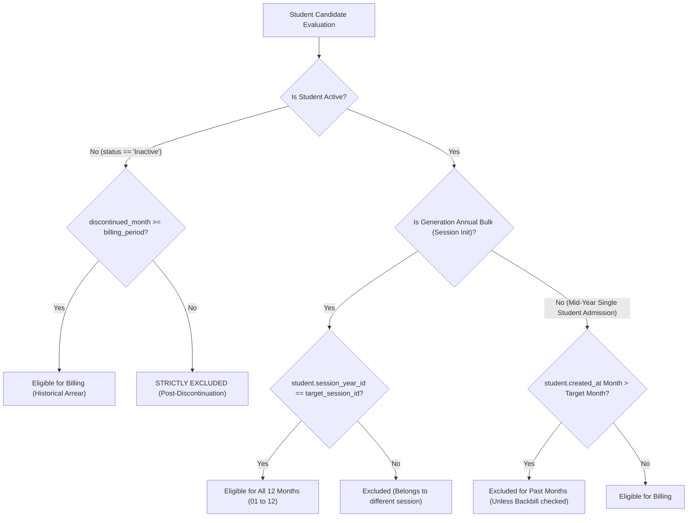

# MACS SCHOOL — ANNUAL INVOICE GENERATION
## FINAL PRE-IMPLEMENTATION VALIDATION & ARCHITECTURAL REVIEW

**Document:** `MACS_ANNUAL_INVOICE_FINAL_PRE_IMPLEMENTATION_REVIEW.md`  
**Review Date:** November 05, 2026  
**Auditor:** Senior Laravel & Database Architect (MACS School Co-Pilot)  
**Status:** COMPLETE PRE-IMPLEMENTATION VALIDATION  
**Mode:** STRICTLY READ-ONLY (Zero Code Edits, Zero Database Mutations, Zero Invoices Generated)

---

### 1. Executive Decision

* **Status:** **PROVISIONALLY APPROVED FOR CONTROLLED PHASED ROLLOUT**
* **Core Verdict:**
  1. **Architecture Viability `[VERIFIED]`:** The existing database schema (`fee_invoices`, `fee_payments`, `fee_setups`, `student_custom_fees`) natively supports 12 pre-generated monthly invoices and multi-month advance collection without adding new tables.
  2. **Concurrency Protection `[VERIFIED]`:** A single **Global MySQL Named Advisory Lock** (`macs_school_fee_invoice_generation_lock`) on a dedicated PDO connection completely eliminates CLI vs Admin UI and Whole-School vs Class-Wise collision.
  3. **Admission Date Reality `[VERIFIED]`:** Database audit proves **542 out of 543 students (99.8%) have `admission_date = NULL`**. Consequently, eligibility logic must NOT rely on `admission_date`.
  4. **Due Report Integrity `[VERIFIED]`:** Database audit proves **100% of the 9,188 existing invoices have a populated `due_date`**, whereas `created_at` currently causes 155 past/future invoices to improperly contaminate monthly reports. Replacing `created_at` with strict `due_date` filtering restores true financial accuracy.
  5. **Implementation Stance:** **GO** — Proceed with Phase 1 (CLI-only prototype with Advisory Lock and automated regression test suite on local database).

---

### 2. Verified Evidence with Exact File Paths and Line References

| Audit Focus Area | Verified Finding in Codebase / Database | Code Reference / Line | Status |
| :--- | :--- | :--- | :---: |
| **No Unique Composite Constraint** | `fee_invoices` table has unique constraint ONLY on `invoice_no`. No DB-level constraint exists for `(student_id, fee_setup_id, month)`. | [database/migrations/2026_04_02_062237_create_fee_invoices_table.php:16](file:///d:/Running%20Works/04.%20Clients%20Back-end%20Projects%20-%202025/PHP%20-%20Laravel/MACS%20School/macs-school/database/migrations/2026_04_02_062237_create_fee_invoices_table.php#L16) | `[VERIFIED]` |
| **Concurrency Race Condition** | In current controller, `$lastSerial` is evaluated outside the transaction, and `$exists` is checked without row or gap locks, risking SQL 1062 duplicate key collisions on simultaneous execution. | [app/Http/Controllers/FeeInvoiceController.php:108-136](file:///d:/Running%20Works/04.%20Clients%20Back-end%20Projects%20-%202025/PHP%20-%20Laravel/MACS%20School/macs-school/app/Http/Controllers/FeeInvoiceController.php#L108-L136) | `[VERIFIED]` |
| **Session Ground Truth** | Only 1 session exists (`ID: 1`, `session_name: '2026'`). All 543 students belong to this session. Invoices strictly format year as 4 digits (`INV-2026MM-XXXX`). | [database/migrations/2026_02_27_171649_create_session_years_table.php:16](file:///d:/Running%20Works/04.%20Clients%20Back-end%20Projects%20-%202025/PHP%20-%20Laravel/MACS%20School/macs-school/database/migrations/2026_02_27_171649_create_session_years_table.php#L16), [app/Models/FeeInvoice.php:64](file:///d:/Running%20Works/04.%20Clients%20Back-end%20Projects%20-%202025/PHP%20-%20Laravel/MACS%20School/macs-school/app/Models/FeeInvoice.php#L64) | `[VERIFIED]` |
| **100% `due_date` Reliability** | 9,188 out of 9,188 invoices in the database (100.0%) have a valid, non-null `due_date`. Standard monthly due date is the 10th (`YYYY-MM-10`). | Database audit query; [app/Console/Commands/FeeAutoGenerate.php:104](file:///d:/Running%20Works/04.%20Clients%20Back-end%20Projects%20-%202025/PHP%20-%20Laravel/MACS%20School/macs-school/app/Console/Commands/FeeAutoGenerate.php#L104) | `[VERIFIED]` |
| **`created_at` Report Contamination** | 5,866 invoices (63.8%) have `due_date` month different from `created_at` month. For September 2026, the current `created_at` query pulled 155 past/future invoices (৳57,800.00) into the September Due Report. | [app/Http/Controllers/FeeReportController.php:31-36](file:///d:/Running%20Works/04.%20Clients%20Back-end%20Projects%20-%202025/PHP%20-%20Laravel/MACS%20School/macs-school/app/Http/Controllers/FeeReportController.php#L31-L36) | `[VERIFIED]` |
| **99.8% Null Admission Dates** | 542 out of 543 students have `admission_date = NULL`. The web admission form does not even include an admission date input. | [database/migrations/2026_02_27_174613_create_students_table.php:19](file:///d:/Running%20Works/04.%20Clients%20Back-end%20Projects%20-%202025/PHP%20-%20Laravel/MACS%20School/macs-school/database/migrations/2026_02_27_174613_create_students_table.php#L19), [resources/views/pages/students/admission.blade.php](file:///d:/Running%20Works/04.%20Clients%20Back-end%20Projects%20-%202025/PHP%20-%20Laravel/MACS%20School/macs-school/resources/views/pages/students/admission.blade.php) | `[VERIFIED]` |
| **Legacy vs New Students** | 535 students were created on `2026-07-22` in bulk (legacy import). 8 students were admitted between August and October 2026. | Database `students.created_at` distribution | `[VERIFIED]` |
| **Mid-Year Admission Variance** | Student 572 (admitted Sep 6) received invoices for Jan–Nov (17 invoices). Student 577 (admitted Oct 14) received invoices ONLY for Oct–Nov (4 invoices). | Database `fee_invoices` audit for IDs 572, 577 | `[VERIFIED]` |
| **Continuous Fee Adjustment Protection** | `adjustInvoiceFee(scope: 'continuous')` strictly excludes invoices with payments (`paid_amount > 0` or existing payments) and updates only unpaid invoices. | [app/Http/Controllers/FeeCollectionController.php:806-813, 833-842](file:///d:/Running%20Works/04.%20Clients%20Back-end%20Projects%20-%202025/PHP%20-%20Laravel/MACS%20School/macs-school/app/Http/Controllers/FeeCollectionController.php#L806-L842) | `[VERIFIED]` |

---

### 3. Remaining Business Decisions Requiring Operator Approval

The following four business policies cannot be inferred from code alone and require explicit confirmation:

1. **Mid-Year Admission Billing Policy `[OPERATOR DECISION NEEDED]`:**
   * When a new student is admitted in the middle of a session (e.g., April 2027), should the system:
     * **Option A (Recommended Default):** Generate invoices only from the admission month onwards (April–December, 9 invoices).
     * **Option B:** Provide an explicit checkbox on the admission form: `[ ] Backbill past months of current session` (generating Jan–Dec, 12 invoices).
2. **Session Name Format Rule `[OPERATOR DECISION NEEDED]`:**
   * Should the application strictly enforce 4-digit calendar years for session names (e.g. `'2027'`), or will multi-year formats (e.g. `'2027-2028'`) be permitted?
   * *Recommendation:* Enforce 4-digit numeric calendar years matching the national primary/secondary curriculum (January–December).
3. **Mid-Year Custom Fee Adjustment Scope `[OPERATOR DECISION NEEDED]`:**
   * If a student's custom fee changes in July (e.g., from 500 BDT to 600 BDT), and January is still *Unpaid*:
     * Should January remain at the historical 500 BDT, or be updated to 600 BDT?
     * *Recommendation:* Add `where('due_date', '>=', $invoice->due_date)` to the continuous adjustment query so that only the selected month and future months update, preserving historical unpaid months at their original rate.
4. **Due Report Periodicity Policy `[OPERATOR DECISION NEEDED]`:**
   * When viewing the Due Report for a monthly date range (e.g. Jan 1 to Jan 31):
     * Should the report show **Only Month-Specific Dues** (`due_date BETWEEN startDate AND endDate`), OR **Cumulative Arrears up to End Date** (`due_date <= endDate`)?
     * *Recommendation:* Provide a clean UI toggle between "Period Dues" and "Total Cumulative Arrears".

---

### 4. Final Concurrency Design

#### 4.1 Why `lockForUpdate()` Alone Is Insufficient `[VERIFIED]`
In MySQL InnoDB:
```sql
SELECT * FROM fee_invoices WHERE invoice_no LIKE 'INV-202701-%' FOR UPDATE;
```
If zero invoices exist for `INV-202701-`, InnoDB cannot place row locks on non-existent records. Gap locking on variable-length prefixes without an existing supremum boundary does not prevent another transaction from concurrently reading `lastSerial = 0` and inserting duplicate serials.

#### 4.2 Single Unified Global Lock Architecture `[VERIFIED]`
To eliminate all conflict between Whole-School CLI generation and Class-Wise Admin UI generation:
1. **Single Canonical Lock Name:**
   $$\text{Lock Name} = \mathbf{\text{'macs\_school\_fee\_invoice\_generation\_lock'}}$$
2. **Dedicated PDO Connection Guarantee:**
   Both CLI and Web Controller must acquire and release the lock using the exact same underlying PDO connection instance:
   ```php
   $pdo = DB::connection()->getPdo();
   $lockName = 'macs_school_fee_invoice_generation_lock';
   
   $stmt = $pdo->prepare("SELECT GET_LOCK(?, 15)");
   $stmt->execute([$lockName]);
   $acquired = (int) $stmt->fetchColumn() === 1;
   
   if (!$acquired) {
       throw new RuntimeException("Another fee generation process is actively running. Please wait 15 seconds and try again.");
   }
   
   try {
       DB::beginTransaction();
       // 1. Lock serial generation
       // 2. Iterate students and insert invoices
       DB::commit();
   } catch (\Throwable $e) {
       DB::rollBack();
       throw $e;
   } finally {
       $releaseStmt = $pdo->prepare("SELECT RELEASE_LOCK(?)");
       $releaseStmt->execute([$lockName]);
   }
   ```
3. **Behavior Matrix:**
   * Admin UI triggers Class Play $\rightarrow$ acquires global lock $\rightarrow$ runs in 1.5 seconds $\rightarrow$ releases lock.
   * CLI runs Whole-School $\rightarrow$ acquires global lock $\rightarrow$ Admin UI clicking "Generate" receives a graceful waiting message or queues until CLI finishes $\rightarrow$ zero collision, zero SQL 1062 errors.

---

### 5. Final Eligibility Rules

Because `students.admission_date` is NULL for 99.8% of students, eligibility is codified into three deterministic tiers:



1. **Tier 1 (Legacy & Annual Session Start):** Any student whose `session_year_id` matches the target session and whose status is `Active` receives all 12 monthly invoices (January–December).
2. **Tier 2 (Mid-Year Admissions):** A student admitted in Month $M$ of Year $Y$ receives invoices from Month $M$ to Month 12.
3. **Tier 3 (Discontinued Students):** Inactive students are strictly excluded for any month after `discontinued_month`. Existing invoices post-discontinuation are automatically cancelled with `due_amount = 0.00`.

---

### 6. Final Minimal File Scope

Implementation is strictly confined to **3 backend files** and **1 frontend template**:

```
app/
├── Console/
│   └── Commands/
│       └── FeeAutoGenerate.php            [MODIFY] -> Add --all-year flag, unified advisory lock, 12-month loop
└── Http/
    └── Controllers/
        ├── FeeInvoiceController.php       [MODIFY] -> Add 'All Months' handling, unified advisory lock
        └── FeeReportController.php        [MODIFY] -> Lines 31-36: Replace created_at fallback with strict due_date
resources/
└── views/
    └── pages/
        └── fees/
            └── invoice_generate.blade.php [MODIFY] -> Add 'All Months (Full Session)' option to Alpine dropdown
```

* **Database Migrations:** **ZERO migrations required**. The existing `fee_invoices` schema supports this architecture without alteration.

---

### 7. Required Regression Tests

Before committing or deploying, the following 10 automated test suites must pass:

1. **Lock Mutual Exclusion:** Run two concurrent processes attempting to generate invoices for the same session; assert second process waits or gracefully aborts without SQL 1062.
2. **12-Month Structure Integrity:** Assert an active student receives exactly 12 invoices (`INV-YYYY01-` to `INV-YYYY12-`) with due dates set to the 10th of each month.
3. **Custom Fee Persistence:** Assert students with `StudentCustomFee` receive identical net amount and discount across all 12 invoices.
4. **Multi-Month Advance Payment:** Assert paying January–March via `FeeCollectionController::bulkStore` marks those 3 invoices `Paid`, generates a consolidated master receipt, and leaves April–December `Unpaid`.
5. **Full Year Advance Payment:** Assert paying all 12 invoices marks all 12 `Paid` with 0 due balance.
6. **Discontinuation Invoice Cancellation:** Assert discontinuing a student in June cancels July–December invoices and reduces due balance to 0.
7. **Continuous Fee Adjustment:** Assert adjusting fee in July updates July–December unpaid invoices and leaves January–June paid invoices untouched.
8. **Due Report Month Isolation:** Assert viewing January Due Report displays 0 invoices from February–December.
9. **Zero Mutation on Historical Data:** Assert baseline count (9,188 invoices, 7,166 payments) and financial sums remain byte-identical.
10. **Thermal Receipt Verification:** Assert POS bulk receipt displays all paid month names in strict chronological order.

---

### 8. Explicit Recommendation: GO / NO-GO

* **Recommendation:** **`GO` (Proceed to Controlled Phase 1 Implementation)**
* **Conditions of Execution:**
  1. No code edits on production.
  2. Implement Phase 1 exclusively in the local development environment on `app/Console/Commands/FeeAutoGenerate.php`.
  3. Execute full regression suite locally against existing database baseline.
  4. Operator reviews test results before extending changes to `FeeInvoiceController` and `FeeReportController`.

---
*End of Final Pre-Implementation Validation Report.*

