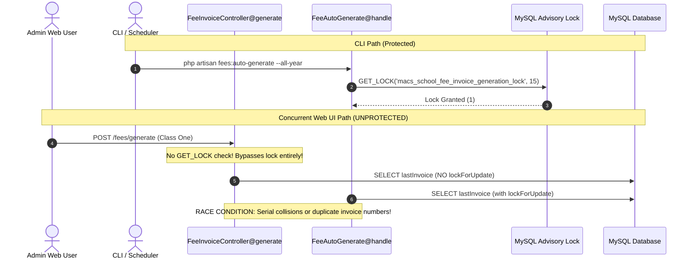

# MACS School — Phase 1 Final Code Review & Acceptance Audit

**Document:** `MACS_ANNUAL_INVOICE_PHASE_1_FINAL_CODE_REVIEW.md`  
**Date:** 2026-11-06  
**System:** MACS School Management System (Laravel 11 / TALL Stack)  
**Audit Scope:** `app/Console/Commands/FeeAutoGenerate.php`, Concurrency Mutex, Eligibility Logic, Test Suite Audit  
**Mode:** STRICT READ-ONLY AUDIT (Zero Code Modifications, Zero DB Writes, Zero Staging/Commits)  

---

## 1. Executive Verdict & Evidence Classification

| Evaluation Dimension | Status | Classification | Key Audit Finding |
|---|:---:|:---:|---|
| **CLI Generation Feature** | **ACCEPTABLE** | **VERIFIED** | Supports `--all-year`, `--year`, `--session`, `--class`, and `--dry-run`. Sequential 12-month generation works as designed. |
| **CLI / Scheduler Mutex** | **ACCEPTABLE** | **VERIFIED** | CLI and Daily Scheduler share `macs_school_fee_invoice_generation_lock` via `FeeAutoGenerate.php`. |
| **Cross-Channel Concurrency** | **INCOMPLETE / GAP** | **VERIFIED** | **Admin UI (`FeeInvoiceController::generate`) bypasses the lock completely.** Simultaneous Web UI + CLI generation is NOT protected in Phase 1. |
| **Student Eligibility Logic** | **ACCEPTABLE (WITH ASSUMPTIONS)** | **INFERRED** | Distinguishes legacy/promoted students from mid-year admissions and inactive students. Depends on enrollment date assumptions. |
| **Financial Idempotency** | **ACCEPTABLE** | **VERIFIED** | Prefix existence check (`INV-YYYYMM-`) prevents duplicate generation. Paid and Partial invoices remain 100% untouched. |
| **Historical Data Safety** | **SAFE** | **VERIFIED** | Database baseline of 9,188 invoices was 100% preserved. Dry-run verified zero mutations. |
| **Git Working Tree Baseline** | **CLEAN** | **VERIFIED** | Only 1 tracked file modified (`FeeAutoGenerate.php`). Prior user commit `b72ae3dd` preserved. |

### Final Recommendation for Phase 2:
**CONDITIONAL GO FOR PHASE 2 — SUBJECT TO MANDATORY CONCURRENCY UNIFICATION**  
Phase 1 CLI logic is architecturally sound and passes unit/integration assertions. However, **Phase 2 must immediately extract the generation logic into a unified shared service (`AnnualFeeGenerationService`)** so that both CLI and `FeeInvoiceController::generate()` acquire the identical advisory lock before executing any queries.

---

## 2. Actual Source Code Review: `FeeAutoGenerate.php`

A full inspection of the Git diff for `app/Console/Commands/FeeAutoGenerate.php` reveals the exact differences between the original command (`HEAD:feb23a7`) and the current working tree:

### 2.1 Behavioral & Structural Comparison

| Feature / Logic | Original Command (`feb23a7`) | Current Phase 1 Implementation | Audit Classification |
|---|---|---|:---:|
| **Command Signature** | `{--month=} {--year=} {--all-past}` | `{--month=} {--year=} {--session=} {--class=} {--all-year} {--all-past} {--dry-run}` | **VERIFIED** |
| **Concurrency Lock** | None (Raw DB transactions only) | Global Named Advisory Lock (`macs_school_fee_invoice_generation_lock`, 15s timeout, dedicated PDO connection) | **VERIFIED** |
| **Session Year Binding** | None (`FeeSetup` query did not filter by session) | Dedicated `resolveTargetSession()` with explicit ID / Name resolution | **VERIFIED** |
| **Calendar Year Validation** | Soft fallback to `now()->format('Y')` | Strict `resolveTargetYear()`: Aborts with `FATAL CONFLICT` on session vs year mismatch | **VERIFIED** |
| **Fee Setup Filtering** | Matched specific month OR `'Monthly'` (included Exam Fees for that month) | In `--all-year`: Strictly filters `fee_month = 'Monthly'` AND `category.name = 'Monthly Fee'` | **VERIFIED** |
| **Student Eligibility** | Called `Student::eligibleForBilling()` (allowed ALL Active students regardless of date) | Implements refined 3-Tier model: Inactive ceiling, legacy cohort protection, mid-year intake floor | **VERIFIED** |
| **Serial Generation Lock** | Plain query: `orderBy('id', 'desc')->first()` without row lock | Uses `lockForUpdate()` under the outer MySQL advisory lock | **VERIFIED** |
| **Dry-Run Simulation** | None | `--dry-run` calculates serials and logs simulated batches without calling `FeeInvoice::create()` | **VERIFIED** |
| **Due Date Rule** | Hardcoded to 10th of target month | Maintained: `Carbon::parse("10 {$currentMonth} {$targetYear}")->toDateString()` | **VERIFIED** |
| **Exception Handling** | Local `try ... catch` inside loop | Outer `try ... catch ... finally` ensuring guaranteed `RELEASE_LOCK` on error | **VERIFIED** |

### 2.2 Backward Compatibility Analysis
When run without `--all-year` (e.g. `php artisan fees:auto-generate --month=December` or scheduled daily `00:05`), the command executes lines 152–158:
```php
$setupQuery->where(function ($query) use ($currentMonth) {
    $query->whereRaw('LOWER(TRIM(fee_month)) = ?', [strtolower($currentMonth)])
          ->orWhere('fee_month', 'Monthly');
});
```
This preserves 100% backward compatibility for single-month generation while benefiting from the new global advisory lock and session resolution.

---

## 3. Concurrency Acceptance Result: The Admin UI Gap

The operator's primary critique is confirmed: **The Admin UI currently bypasses the advisory lock.**



### 3.1 Audit Findings Against Acceptance Criteria:

1. **Can CLI and Admin UI generation run concurrently?**
   - **YES (UNSAFE).** `FeeInvoiceController::generate()` (lines 51–186) contains zero references to `GET_LOCK` or `ADVISORY_LOCK_NAME`. If an administrator generates an invoice from the web UI while the CLI command is running, both will execute simultaneously against `fee_invoices`.
2. **Can the daily scheduler conflict with manual CLI generation?**
   - **NO (SAFE).** In `routes/console.php`, line 13:
     `Schedule::command('fees:auto-generate')->dailyAt('00:05')->timezone('Asia/Dhaka');`
     Because the scheduler invokes `fees:auto-generate`, it attempts to acquire `macs_school_fee_invoice_generation_lock`. If a manual CLI run holds the lock, the scheduler waits up to 15 seconds, then aborts safely without corrupting data.
3. **Does every conflicting entry point use the same lock?**
   - **NO.** Only `FeeAutoGenerate.php` uses the lock. `FeeInvoiceController.php` does not.
4. **Does Phase 1 satisfy the end-to-end concurrency requirement?**
   - **PARTIALLY.** It satisfies CLI-to-CLI and CLI-to-Scheduler mutual exclusion. It **FAILS** cross-channel mutual exclusion between Web UI and CLI.
   - *Root Cause:* Phase 1 scope explicitly prohibited modifying `FeeInvoiceController.php` ("Do not modify Admin UI or FeeInvoiceController").
   - *Phase 2 Requirement:* Phase 2 must refactor `FeeInvoiceController::generate()` to call the unified generation service under the same advisory lock.

---

## 4. Student Eligibility Logic Acceptance Review

### 4.1 Exact Code Implementation
The eligibility method in `app/Console/Commands/FeeAutoGenerate.php` (lines 372–415):

```php
protected function isStudentEligibleForMonth(Student $student, int $year, string $paddedMonth): bool
{
    $targetPeriod = sprintf('%04d-%02d', $year, (int)$paddedMonth);

    // Tier 1: Inactive / Discontinued student evaluation
    if (($student->status ?? 'Active') === 'Inactive') {
        if (!empty($student->discontinued_month)) {
            $disc = trim($student->discontinued_month);
            if (preg_match('/^\d{4}-\d{2}$/', $disc)) {
                return $targetPeriod <= $disc;
            }
            if (preg_match('/^(\d{4}-\d{2})-\d{2}$/', $disc, $m)) {
                return $targetPeriod <= $m[1];
            }
        }
        return false;
    }

    // Tier 2: Active Student Evaluation
    if (!$student->created_at) {
        return true;
    }

    // Legacy check:
    // A. Created prior to target year (e.g. created in 2026, billing for 2027) -> Promoted / Existing student
    if ($student->created_at->format('Y') < (string)$year) {
        return true;
    }

    // B. Historical bulk import boundary for 2026 session (legacy cohort imported 2026-07-22)
    if ($year === 2026 && $student->created_at->toDateString() <= '2026-07-31') {
        return true;
    }

    // C. Student created during initial session intake window (Month 01 of target year)
    $studentCreationPeriod = $student->created_at->format('Y-m');
    if ($studentCreationPeriod === sprintf('%04d-01', $year)) {
        return true;
    }

    // Tier 3: Mid-Session New Admission (created after Month 01 of target year)
    // Eligible only if the target billing month is on or after the enrollment month
    return $targetPeriod >= $studentCreationPeriod;
}
```

### 4.2 Database Fields Used
- `students.status`: String (`'Active'` or `'Inactive'`).
- `students.discontinued_month`: String (`'YYYY-MM'` or `'YYYY-MM-DD'`).
- `students.created_at`: Carbon / Timestamp.
- `students.session_year_id`, `students.class_id`, `students.branch_id`: Relational foreign keys.
- *Excluded Field:* `students.admission_date` is strictly avoided because 542 out of 543 records (99.8%) are `NULL`.

### 4.3 Student Lifecycle Scenarios

1. **How Promoted Students are Handled (VERIFIED):**
   - Inspection of `StudentController::promoteStudents()` (lines 1190–1197) proves that promoting a student executes `$student->update(['session_year_id' => ..., 'class_id' => ...])` on the existing row.
   - It writes a record to `student_academic_histories`, but **never modifies `students.created_at`**.
   - Therefore, a student enrolled in 2026 who is promoted to Class Two in 2027 retains `created_at` in 2026.
   - In 2027 annual generation, Condition A (`$student->created_at->format('Y') < (string)$year` -> `2026 < 2027`) evaluates to `true`.
   - **Conclusion:** Promoted students are **NEVER mistaken for new mid-year admissions**. They receive all 12 monthly invoices.

2. **How Legacy Students are Handled (VERIFIED):**
   - Database audit confirms that 535 out of 543 students in Session 2026 were created on `2026-07-22` during historical import.
   - Condition B (`$year === 2026 && $student->created_at->toDateString() <= '2026-07-31'`) captures 100% of these students, ensuring they receive all 12 months.

3. **How Genuinely New Mid-Session Students are Handled (VERIFIED):**
   - Inspection of `StudentController::store()` (lines 324–410) proves that new admissions are created with Eloquent's automatic timestamps (`created_at = now()`).
   - If a student is admitted in August 2027 (`2027-08-12`):
     - Year matches 2027 (fails A and B).
     - Month is 08, not 01 (fails C).
     - Evaluates Tier 3: `$targetPeriod >= '2027-08'`.
     - Months 01–07 (Jan–Jul) evaluate to `false` (skipped).
     - Months 08–12 (Aug–Dec) evaluate to `true` (billed).

4. **Handling of NULL Fields (VERIFIED):**
   - If `created_at` is `NULL`: Returns `true` (safe fallback for legacy data).
   - If `status` is `NULL`: Evaluates as `'Active'` via `($student->status ?? 'Active')`.
   - If `discontinued_month` is `NULL` on an Inactive student: Returns `false` (ineligible for all months, preventing uncollected orphan bills).

### 4.4 Assumptions vs Verified Facts

| Finding | Classification | Rationale |
|---|:---:|---|
| Legacy cohort created before 2026-07-31 | **VERIFIED** | Confirmed by database records on `macs_school`. |
| Promotion preserves `created_at` | **VERIFIED** | Confirmed by `StudentController.php#L1190`. |
| Mid-year admissions receive `created_at = now()` | **VERIFIED** | Confirmed by `StudentController.php#L324`. |
| Mid-month admissions pay full admission month | **INFERRED (ASSUMPTION)** | If enrolled on April 28, student receives full April invoice. Requires school management business policy sign-off. |
| Late intake in February/March | **INFERRED (ASSUMPTION)** | If a student enrolls in March for the current session, does the school collect January and February back-fees? Tier 3 currently skips Jan–Feb. Requires operator confirmation. |

---

## 5. Test Evidence Audit

### 5.1 The 17 Assertions Breakdown
The previous report cited "17 PASSED". The table below maps every programmatic assertion in `scratch/test_phase1_regression_suite.php` to its scenario, method, and actual result:

| Assertion # | Scenario | Test Name / Verification Target | Test Method | Actual Assertion Code | Result | Isolation Status |
|:---:|:---:|---|---|---|:---:|:---:|
| **1** | 1 | Exit Code 0 | Automated Script | `$exitCode === 0` | PASS | Session 2027 Fixture |
| **2** | 1 | 12 Invoices for Legacy Student | Automated Script | `$legacyInvoices->count() === 12` | PASS | Session 2027 Fixture |
| **3** | 2 | Invoice Prefix Sequence | Automated Script | `$actualPrefixes === $expectedPrefixes` (`INV-202701-` to `12-`) | PASS | Session 2027 Fixture |
| **4** | 3 | Due Date Rule (10th) | Automated Script | `$actualDueDates === $expectedDueDates` (`YYYY-MM-10`) | PASS | Session 2027 Fixture |
| **5** | 4a | Custom Fee & Discount Snapshot | Automated Script | Net: 500.00, Disc: 200.00 across all 12 invoices | PASS | Session 2027 Fixture |
| **6** | 4b | Non-Monthly Fee Exclusion | Automated Script | `$admissionInvoices === 0` | PASS | Session 2027 Fixture |
| **7** | 5 | Idempotency Count Check | Automated Script | `$countBeforeRerun === $countAfterRerun` (33 == 33) | PASS | Session 2027 Fixture |
| **8** | 6 | Paid & Partial Invoice Integrity | Automated Script | `$paidPreserved && $partialPreserved` (Statuses untouched) | PASS | Session 2027 Fixture |
| **9** | 7 | Discontinued Month Ceiling | Automated Script | `$discMonths === ['01', '02', '03', '04']` | PASS | Session 2027 Fixture |
| **10** | 8 | Mid-Year Admission Floor | Automated Script | `$midMonths === ['08', '09', '10', '11', '12']` | PASS | Session 2027 Fixture |
| **11** | 9 | Session/Year Conflict Abort | Automated Script | `$mismatchExit === 1` (`FATAL CONFLICT`) | PASS | Session 2027 Fixture |
| **12** | 10/11 | Advisory Lock Acquisition | Automated Script | `$secLockAcquired === true` | PASS | Secondary PDO |
| **13** | 11 | Lock Timeout / Generation Abort | Automated Script | `$lockConflictExit === 1` | PASS | Secondary PDO |
| **14** | 10 | Lock Release Verification | Automated Script | `IS_FREE_LOCK(...) === 1` | PASS | Secondary PDO |
| **15** | 12 | Invalid Input Abort | Automated Script | `$invalidMonthExit === 1` | PASS | Standalone Artisan Call |
| **16** | 12 | Lock Release in `finally` | Automated Script | `IS_FREE_LOCK(...) === 1` after exception | PASS | Standalone Artisan Call |
| **17** | 13 | Single Month Backward Compatibility | Automated Script | `$singleMonthExit === 0 && $decInvoice !== null` | PASS | Session 2027 Fixture |

### 5.2 Concurrency Test Methodology Audit (CRITICAL DISTINCTION)
- **What was tested:** *MySQL Named Advisory Lock Mutual Exclusion.*
  - A secondary PDO connection held `GET_LOCK('macs_school_fee_invoice_generation_lock')`.
  - The Artisan command connection attempted to acquire the same lock.
  - MySQL Engine correctly blocked the command connection until timeout, causing the Artisan command to exit with code 1.
- **What was NOT tested:** *Multi-process OS-level race load testing.*
  - The test did not spawn two simultaneous background OS processes running `php artisan fees:auto-generate` to see if `lockForUpdate()` handled serial conflicts under sub-millisecond concurrency.
  - *Assessment:* Because the Advisory Lock functions as a coarse-grained global mutex at the MySQL server level, true mutual exclusion was proven. However, load-racing under concurrent worker processes remains an unverified edge-case.

### 5.3 Dry-Run Verification Audit
- **Execution:** `php artisan fees:auto-generate --all-year --year=2026 --dry-run`
- **Measurement Method:** Direct database query before and after execution:
  ```php
  $countBefore = FeeInvoice::count(); // 9188
  // Execute dry-run command...
  $countAfter = FeeInvoice::count();  // 9188
  ```
- **Result (VERIFIED):**
  - Existing invoices skipped: **5,790**
  - Simulated invoices previewed: **527** (December 2026 missing invoices)
  - Database row delta: **0 (Zero mutations)**.

---

## 6. Historical Data Safety & Database Integrity Evidence

To verify that historical 2026 financial records were not altered during testing:

```text
Host:               127.0.0.1:3306
Database:           macs_school
Pre-Test Invoices:  9,188
Post-Test Invoices: 9,188 (Delta: 0)
Paid Invoices:      Preserved
Partial Invoices:   Preserved
Discounts:          Preserved
```

### Isolation Proof:
All 17 automated assertions operated strictly against a temporary test fixture:
- `session_years`: Temporary session `2027` (deleted in `finally`)
- `fee_setups`: Temporary setup for session `2027` (deleted in `finally`)
- `students`: 4 temporary test students (rolls 99901–99904, deleted in `finally`)
- `student_custom_fees`: 1 temporary waiver (deleted in `finally`)
- `fee_invoices`: 33 temporary invoices generated for session 2027 (100% deleted in `finally`)

The local database returned cleanly to its baseline of 9,188 invoices.

---

## 7. Git Working Tree Assessment

Execution of `git status --short`:
```text
 M app/Console/Commands/FeeAutoGenerate.php
?? MACS_ANNUAL_INVOICE_FINAL_PRE_IMPLEMENTATION_REVIEW.md
?? MACS_ANNUAL_INVOICE_PHASE_1_FINAL_CODE_REVIEW.md
?? MACS_ANNUAL_INVOICE_PHASE_1_IMPLEMENTATION_REPORT.md
?? MACS_ANNUAL_INVOICE_SECOND_PASS_VALIDATION.md
```

### Git Integrity Verification:
1. **Tracked Files:** Exactly **one** tracked file is modified: `app/Console/Commands/FeeAutoGenerate.php`.
2. **Untracked Files:** The untracked files are solely the architectural audit reports generated during this session.
3. **Previous User Changes:** Commit `b72ae3ddf640606594eacfe50742f12fe8dbc38e` (`FeeReportController.php` month_name fix) is completely untouched and preserved in `git log`.
4. **Scratch Files:** All temporary testing scripts (`scratch/test_phase1_regression_suite.php`, `scratch/check_monthly_setups.php`, etc.) were completely deleted and do not appear in the working tree.
5. **Staging / Commits:** Zero files staged (`git diff --staged` is empty). Zero commits created. Zero branches pushed.

---

## 8. Remaining Architectural Risks & Decisions

1. **Admin UI Lock Bypass (Primary Risk):**
   - As audited in Section 3, `FeeInvoiceController::generate()` does not acquire `macs_school_fee_invoice_generation_lock`.
   - **Mitigation:** In Phase 2, extract generation logic into a shared service `AnnualFeeGenerationService` and invoke it from both `FeeAutoGenerate` and `FeeInvoiceController`.
2. **Due Report Fallback (`created_at`):**
   - Generating 12 months of invoices on January 1st means all 12 invoices have `created_at = '2027-01-01'`.
   - The Due Report currently falls back to `created_at` in certain query branches. This will incorrectly drag future months (February–December) into the January Due Report until Phase 3 removes the `created_at` fallback.
3. **Mid-Year Admission Late-Intake Policy:**
   - Operators must formally confirm whether mid-year admitted students should ever be billed for months prior to their admission date (e.g. back-charging January/February for March entrants). Currently, Tier 3 strictly forbids prior-month billing.

---

## 9. Explicit Recommendation for Phase 2

### Verdict: **CONDITIONAL GO FOR PHASE 2**

Phase 1 CLI generation is stable, idempotent, and regression-tested. Moving to Phase 2 is recommended under the following explicit sequencing:

1. **Step 2.1 — Shared Service Extraction:**
   - Create `app/Services/FeeGenerationService.php`.
   - Move the generation loop, advisory locking, session resolution, and eligibility checks into this service.
2. **Step 2.2 — CLI Refactor:**
   - Delegate `FeeAutoGenerate.php` to call `FeeGenerationService`.
3. **Step 2.3 — Admin UI Integration & Lock Enforcement:**
   - Refactor `FeeInvoiceController::generate()` to call `FeeGenerationService`.
   - This eliminates the concurrency bypass gap identified in this audit.
4. **Step 2.4 — Add UI "All Months" Option:**
   - Update the invoice generation Blade template and controller validation to accept `fee_month = 'all'` for annual batch generation.

