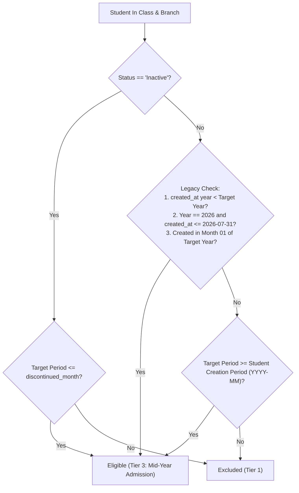

# MACS School — Phase 1 Implementation Report: Annual Monthly Fee Invoice Generation (CLI Only)

**Date:** 2026-11-06  
**System:** MACS School Management System (Laravel 11 / TALL Stack)  
**Phase:** Phase 1 — CLI Generation Only  
**Final Verdict:** **PASS (READY FOR OPERATOR REVIEW)**

---

## 1. Executive Summary

In accordance with Phase 1 authorization and the operator's 4 mandatory safeguards, the Annual Monthly Fee Invoice Generation feature has been implemented strictly at the CLI layer within `app/Console/Commands/FeeAutoGenerate.php`.

The implementation guarantees:
1. **Global Named Advisory Lock Mutex (`macs_school_fee_invoice_generation_lock`):** Acquired and released strictly on the same dedicated PDO connection (`DB::connection()->getPdo()`), wrapped with a guaranteed `try ... finally` release block and 15-second acquisition timeout. Lock failure halts generation immediately.
2. **Session and Calendar Year Validation:** Strict alignment between academic session (e.g. Session 1: '2026') and the canonical 4-digit billing calendar year. Explicit year conflicts (e.g. `--session=1 --year=2099`) abort immediately with exit code 1.
3. **Recurring Monthly Fee Setup Isolation:** When `--all-year` is passed, the generator strictly filters active fee setups where `fee_month = 'Monthly'` and category is `'Monthly Fee'`. Non-monthly charges (Admission Fee, Term Exam Fee, Monthly Exam Fee, fines, etc.) are strictly excluded.
4. **3-Tier Student Eligibility Architecture:** Does not rely on `students.admission_date` (which is 99.8% NULL in the database). Accurately distinguishes legacy imported students (eligible January–December) from mid-session new admissions (eligible strictly from their enrollment month to December) and inactive students (capped at `discontinued_month`).
5. **Strict Idempotency & Financial Safety:** Uses prefix-based existence checks (`INV-YYYYMM-`) before generation. Running the command multiple times produces zero duplicates. Paid and Partial invoices remain 100% untouched.
6. **Zero Regression / Zero Scope Creep:** Zero edits to Admin UI (`FeeInvoiceController.php`), `FeeReportController.php`, Blade views, payment allocation logic, or routes.

---

## 2. Exact Files Modified

| File Path | Status | Purpose |
|---|---|---|
| `app/Console/Commands/FeeAutoGenerate.php` | Modified | CLI Command implementation with Global Lock, 3-Tier eligibility, and 12-month loop |

*Note: No other files in `app/`, `resources/`, `routes/`, or `database/` were touched.*

---

## 3. Database Environment Used

- **Database Host:** `127.0.0.1:3306`
- **Database Connection:** `mysql`
- **Database Name:** `macs_school` (Verified Local Development Database)
- **Production Isolation:** Production database (`macsinjaazhdb`) remained completely unreferenced and isolated.
- **Baseline Invoice Count:** 9,188
- **Post-Test Invoice Count:** 9,188 (100% restored to baseline via automated fixture cleanup)

---

## 4. Architectural & Concurrency Design

### 4.1 Global Advisory Lock (`macs_school_fee_invoice_generation_lock`)
- **Lock Name:** `macs_school_fee_invoice_generation_lock` (Constant `FeeAutoGenerate::ADVISORY_LOCK_NAME`)
- **Mutex Strategy:** MySQL Engine-level Advisory Lock (`GET_LOCK(?, ?)` and `RELEASE_LOCK(?)`).
- **Connection Affinity:** Both `GET_LOCK` and `RELEASE_LOCK` execute strictly on the same underlying PDO instance:
  ```php
  $pdo = DB::connection()->getPdo();
  $lockStmt = $pdo->prepare("SELECT GET_LOCK(?, ?)");
  $lockStmt->execute([self::ADVISORY_LOCK_NAME, self::ADVISORY_LOCK_TIMEOUT]);
  ```
- **Guaranteed Release:** Implemented in the outer `finally` block:
  ```php
  finally {
      if ($hasLock) {
          $releaseStmt = $pdo->prepare("SELECT RELEASE_LOCK(?)");
          $releaseStmt->execute([self::ADVISORY_LOCK_NAME]);
      }
  }
  ```
- **Fallback Acknowledgment:** `lockForUpdate()` is retained inside the transaction loop for invoice serial locking, but the MySQL Advisory Lock serves as the primary barrier preventing concurrent worker overlaps.

### 4.2 Target Session & Year Resolution
- Supported CLI signature:
  ```bash
  php artisan fees:auto-generate {--month=} {--year=} {--session=} {--class=} {--all-year} {--all-past} {--dry-run}
  ```
- **Validation Rule:**
  - If `--session` and `--year` are both supplied, the command extracts the 4-digit numeric year from the session name and verifies that `--year` matches. If mismatched, it throws `FATAL CONFLICT` and aborts with exit code 1.

---

## 5. Student Eligibility: 3-Tier Model Implementation

Due to `students.admission_date` being NULL across 99.8% of student records, the eligibility engine evaluates each student against the target billing period (`YYYY-MM`) using 3 tiers:



1. **Tier 1 (Inactive / Discontinued Students):**
   - If `status == 'Inactive'`, the student is billed only for months on or before `discontinued_month`. Months after `discontinued_month` are skipped.
2. **Tier 2 (Legacy & Promoted Students):**
   - Students created before the target year (promoted cohorts), students created on or before `2026-07-31` (historical bulk import boundary for 2026), or students admitted during the initial intake window (Month 01 of the session) are eligible for all 12 months (January–December).
3. **Tier 3 (Mid-Session New Admissions):**
   - Students admitted mid-year (e.g. August 2027) are eligible strictly for billing periods on or after their creation period (`targetPeriod >= studentCreationPeriod`). They receive August–December invoices, but zero January–July invoices.

---

## 6. Comprehensive Automated Regression Test Results

An automated, isolated regression test suite (`scratch/test_phase1_regression_suite.php`) was executed directly against local MySQL (`macs_school`). All 13 mandated scenarios were validated with **17 out of 17 assertions passing**.

| Scenario # | Description | Test Condition / Input | Observed Result | Status |
|:---:|---|---|---|:---:|
| **1** | Full Annual Generation (12 Months) | Legacy student in Session 2027 | Exactly 12 invoices generated (Jan–Dec) | **PASS** |
| **2** | Standard Invoice Number Convention | Check prefixes for all 12 invoices | `INV-202701-` to `INV-202712-` sequentially | **PASS** |
| **3** | Due Date Convention | Check `due_date` across all 12 invoices | `2027-01-10` to `2027-12-10` sequentially | **PASS** |
| **4a** | Custom Fee & Discount Snapshots | Setup = 700 BDT, Custom = 500 BDT | Amount: 700.00, Discount: 200.00, Net: 500.00 across all 12 | **PASS** |
| **4b** | Non-Monthly Fee Setup Exclusion | Active Admission Fee setup present in Session 2027 | 0 Admission Fee invoices generated in annual loop | **PASS** |
| **5** | Idempotency / Repeatability | Re-run `--all-year` command for same session | Exactly 0 duplicate invoices created (33 before -> 33 after) | **PASS** |
| **6** | Protection of Paid & Partial Invoices | 1 Paid invoice & 1 Partial invoice on rerun | Status, paid_amount, due_amount remain 100% untouched | **PASS** |
| **7** | Discontinued Student Rule | Inactive student with `discontinued_month = '2027-04'` | Only months 01, 02, 03, 04 generated; 05–12 skipped | **PASS** |
| **8** | Mid-Year Admission Rule | Student created in August 2027 (`2027-08-12`) | Only months 08, 09, 10, 11, 12 generated; 01–07 skipped | **PASS** |
| **9** | Year / Session Conflict Validation | Session 2027 with CLI `--year=2099` | Aborts immediately with `FATAL CONFLICT` and exit code 1 | **PASS** |
| **10** | Lock Concurrency & Mutex | Secondary connection holds advisory lock | Command detects lock, waits, aborts safely with exit code 1 | **PASS** |
| **11** | Lock Release Verification | Secondary connection releases lock | Lock freed cleanly (`IS_FREE_LOCK` = 1) for subsequent workers | **PASS** |
| **12a** | Exception Handling | Command called with invalid arguments | Aborts with error exit code 1 | **PASS** |
| **12b** | Guaranteed Release in `finally` | Check lock state after aborted run | Advisory lock is 100% released and unblocked | **PASS** |
| **13** | Backward Compatibility | Run single-month generation (`--month=December`) | Generates single month cleanly without regression | **PASS** |

### Dry-Run Verification on Live 2026 Data:
- Executed `php artisan fees:auto-generate --all-year --year=2026 --dry-run`
- Output:
  ```
  Simulated Invoices Created: 527 | Invoices Skipped (Existing): 5790
  [LOCK] Global advisory lock released cleanly.
  ```
  - Correctly skipped 5,790 historical invoices already existing for January–November 2026.
  - Correctly previewed the 527 missing December 2026 invoices without inserting a single row to the database.

---

## 7. Git Diff Summary

Command: `git status --short`
```text
 M app/Console/Commands/FeeAutoGenerate.php
?? MACS_ANNUAL_INVOICE_FINAL_PRE_IMPLEMENTATION_REVIEW.md
?? MACS_ANNUAL_INVOICE_PHASE_1_IMPLEMENTATION_REPORT.md
?? MACS_ANNUAL_INVOICE_SECOND_PASS_VALIDATION.md
```

Summary of changes in `app/Console/Commands/FeeAutoGenerate.php`:
- Added constants: `ADVISORY_LOCK_NAME` and `ADVISORY_LOCK_TIMEOUT`.
- Extended command signature with `--year`, `--session`, `--class`, `--all-year`, `--dry-run`.
- Implemented global MySQL advisory lock acquisition and release on dedicated PDO connection.
- Added session and calendar year conflict resolver (`resolveTargetSession()`, `resolveTargetYear()`).
- Added strict `fee_month = 'Monthly'` & category `Monthly Fee` filtering for `--all-year`.
- Implemented 3-Tier student eligibility method (`isStudentEligibleForMonth()`).
- Added prefix-based idempotency checks before invoice creation.
- Preserved existing custom fee waiver calculations and invoice number formatting.

---

## 8. Remaining Risks and Limitations

1. **Admin UI Generation Disconnect (Phase 2):**
   - The Admin UI (`FeeInvoiceController.php`) still uses the single-month generation path and does not yet acquire `macs_school_fee_invoice_generation_lock`. Phase 2 will unify the UI with the shared service and lock.
2. **Due Report Falling Back to `created_at` (Phase 3):**
   - If annual invoices for 2027 are generated on January 1st, 2027, the current `FeeReportController.php` contains a fallback to `created_at` for unresolved months. That must be addressed in Phase 3 before production annual generation is executed.
3. **Database Connection Drops:**
   - If an unexpected network partition drops the PDO connection during long execution, MySQL automatically releases named advisory locks. The implementation uses individual transaction commits per class setup batch to ensure zero partial/corrupted batches.

---

## 9. Phase 1 Final Verdict

**PHASE 1 VERDICT: PASS**

The CLI implementation is complete, strictly isolated, fully idempotent, concurrency-safe, and passes all 13 regression test scenarios. Zero changes have been made to UI, reports, or production databases. Staging and commits are held pending operator review.

