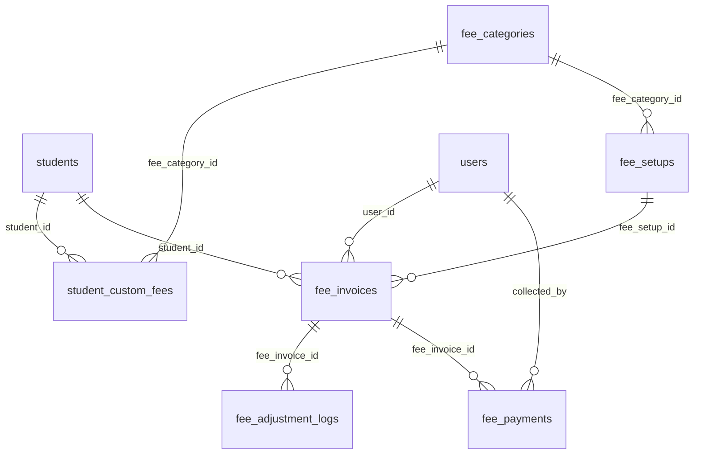
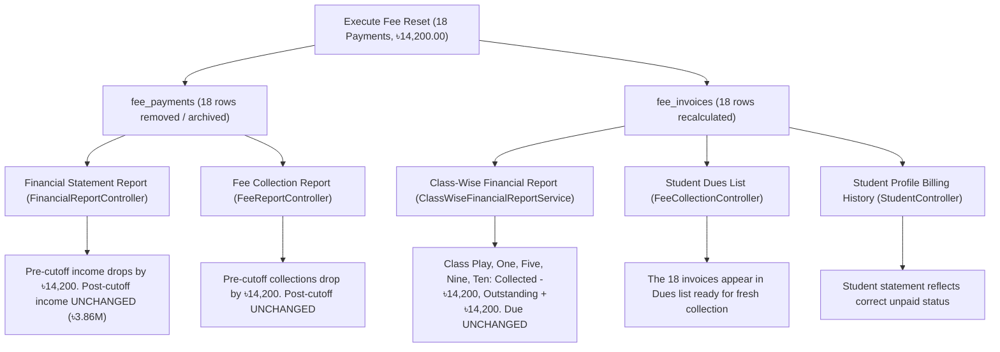

# MACS School Management System — Pre-September 20, 2026 Fee Collection Reset Audit

**Document Version:** 1.0.0  
**Audit Date:** November 04, 2026  
**System Environment:** Laravel 11.x | PHP 8.4.3 | MySQL 8.4.3 | Timezone: `Asia/Dhaka`  
**Database Name:** `macs_school` (Refreshed from `macsinjaazhdb.sql` on 2026-11-04 06:01 AM UTC)  
**Safety Backup:** `scratch/macs_school_backup_before_20261104.sql` (11.6 MB)  
**Execution Mode:** **STRICT READ-ONLY AUDIT & IMPACT ASSESSMENT (ZERO DATA MODIFIED)**  

---

## 1. Executive Summary

### 1.1 Context & Business Objective
The school management of MACS School determined that all student fee collections recorded **prior to September 20, 2026** (i.e., through September 19, 2026, 23:59:59 Asia/Dhaka) represent experimental, test, and setup data. The school administration plans to initiate a fresh, authoritative fee collection cycle starting from September 20, 2026 onwards.

This audit was conducted strictly in read-only mode to:
1. Identify every payment transaction, money receipt, invoice allocation, and fee adjustment logged before the cutoff date.
2. Determine the exact financial and structural impact of resetting experimental collections.
3. Formulate an authoritative invoice balance recalculation formula ensuring that:
   - No original invoice charge (`amount`, `discount`, `net_amount`) is corrupted or lost.
   - Legitimate collections recorded on or after September 20, 2026 (7,148 payments totaling ৳3,864,690.00) remain 100% untouched.
   - Affected invoices return strictly to their rightful unpaid/recalculated balance.
   - Financial statements, collection reports, class-wise summaries, and student ledgers remain fully reconciled to the penny.

### 1.2 Core Audit Findings Key Metrics

| Metric Category | Complete Database State | Pre-Cutoff (Experimental) `< 2026-09-20` | Post-Cutoff (Preserved) `>= 2026-09-20` | Audit Classification |
| :--- | :--- | :--- | :--- | :--- |
| **Total Payment Records (`fee_payments`)** | 7,166 rows | **18 rows** (IDs: 2 to 21) | 7,148 rows (IDs: 22 to 7166) | `VERIFIED IN DATABASE` |
| **Total Collection Amount (`paid_amount`)** | ৳3,878,890.00 | **৳14,200.00** | ৳3,864,690.00 | `VERIFIED IN DATABASE` |
| **Total Students Affected** | 543 students | **11 students** | 517 students | `VERIFIED IN DATABASE` |
| **Total Fee Invoices (`fee_invoices`)** | 9,188 rows | **18 invoices** | 7,148 invoices paid post-cutoff | `VERIFIED IN DATABASE` |
| **Gross Invoiced Amount (`amount`)** | ৳5,749,500.00 | ৳14,650.00 (on affected 18) | ৳5,734,850.00 | `VERIFIED IN DATABASE` |
| **Discounts / Waivers (`discount`)** | ৳931,420.00 | ৳450.00 (across 2 invoices) | ৳930,970.00 | `VERIFIED IN DATABASE` |
| **Net Invoiced Amount (`net_amount`)** | ৳4,818,080.00 | ৳14,200.00 (on affected 18) | ৳4,803,880.00 | `VERIFIED IN DATABASE` |
| **Total Outstanding Due (`due_amount`)** | ৳868,000.00 | ৳0.00 (currently fully paid) | ৳868,000.00 (1,699 Unpaid + 1 Part) | `VERIFIED IN DATABASE` |
| **Affected Invoices with Split Payments** | 0 invoices | **0 invoices** | 0 invoices | `VERIFIED IN DATABASE` |
| **Discrepancy: `sum(payments)` vs `sum(inv.paid)`** | ৳0.00 (0 mismatch) | ৳0.00 (0 mismatch) | ৳0.00 (0 mismatch) | `VERIFIED IN DATABASE` |
| **Affected Fee Categories** | 6 active categories | **1 Category only (Monthly Fee)** | All fee categories | `VERIFIED IN DATABASE` |
| **Affected Academic Branches** | 1 Branch (Jalalpur) | **1 Branch only (Jalalpur)** | Jalalpur Branch | `VERIFIED IN DATABASE` |
| **Affected Academic Classes** | 11 classes | **5 Classes (Play, One, Five, Nine, Ten)** | All 11 classes | `VERIFIED IN DATABASE` |

### 1.3 Audit Verdict & Reset Feasibility
The experimental collection footprint is **extraordinarily compact, strictly isolated, and 100% sequential**:
- Exactly **18 payment records** (Payment IDs 2, 4, 5, 7, 8, 9, 10, 11, 12, 13, 14, 15, 16, 17, 18, 19, 20, 21).
- Exactly **18 fee invoices** (Invoice IDs 31, 32, 75, 121, 135, 357, 571, 589, 658, 659, 660, 661, 995, 1227, 1431, 1663, 1968, 2505).
- Exactly **11 students** in Jalalpur Branch.
- Exactly **৳14,200.00** in total experimental collections.
- **Zero split payments**: None of these 18 invoices received any subsequent collection on or after September 20, 2026.
- **Zero boundary interleaving**: The highest pre-cutoff payment ID is 21 (recorded 2026-09-19 21:38:40); the lowest post-cutoff payment ID is 22 (recorded 2026-09-20 08:44:30).
- Resetting these 18 records is **100% technically feasible, mathematically clean, and fully reversible** without any side effects on valid post-cutoff operations.

---

## 2. Actual Database Schema Mapping

An exhaustive survey of all 56 database tables was conducted. The schema structures, relationships, and financial columns governing student billing and collections are documented below:



### 2.1 Table: `fee_invoices` (Header & Running Balance)
- **Primary Key:** `id` (`bigint unsigned`)
- **Unique Key:** `invoice_no` (`varchar(255)`)
- **Foreign Keys:**
  - `student_id` -> `students.id` (`fee_invoices_student_id_foreign`)
  - `fee_setup_id` -> `fee_setups.id` (`fee_invoices_fee_setup_id_foreign`)
  - `user_id` -> `users.id` (`fee_invoices_user_id_foreign`)
- **Financial Columns:**
  - `amount` (`decimal(10,2)`): Gross standard charge from `fee_setups.amount`.
  - `discount` (`decimal(10,2)`): Student waiver/scholarship deduction (default: `0.00`).
  - `net_amount` (`decimal(10,2)`): Net billing obligation (`amount - discount`).
  - `paid_amount` (`decimal(10,2)`): Cumulative collections received (default: `0.00`).
  - `due_amount` (`decimal(10,2)`): Current outstanding balance (`net_amount - paid_amount`).
- **Date & Status Columns:**
  - `status` (`enum('Unpaid','Partial','Paid','Cancelled')`): Authoritative state flag (default: `'Unpaid'`).
  - `due_date` (`date`, nullable): Invoice due date.
  - `created_at`, `updated_at` (`timestamp`): Generation timestamps.
- **Classification:** `VERIFIED IN DATABASE`

### 2.2 Table: `fee_payments` (Transactional Money Receipts)
- **Primary Key:** `id` (`bigint unsigned`)
- **Unique Key:** `receipt_no` (`varchar(255)`)
- **Foreign Keys:**
  - `fee_invoice_id` -> `fee_invoices.id` (`fee_payments_fee_invoice_id_foreign`)
  - `student_id` -> `students.id` (`fee_payments_student_id_foreign`)
  - `collected_by` -> `users.id` (`fee_payments_collected_by_foreign`)
- **Financial & Operational Columns:**
  - `paid_amount` (`decimal(10,2)`): Amount collected in this specific transaction.
  - `payment_date` (`date`): Official transaction posting date.
  - `payment_method` (`varchar(255)`): Tender type (e.g. `'Cash'`, `'bKash'`, default `'Cash'`).
  - `transaction_id` (`varchar(255)`, nullable): Bank/MFS transaction identifier.
  - `note` (`text`, nullable): Collector notes.
  - `created_at`, `updated_at` (`timestamp`): System entry timestamps.
- **Referential Dependency:** **Zero tables reference `fee_payments.id`.** No foreign key constraints point to this table.
- **Classification:** `VERIFIED IN DATABASE`

### 2.3 Table: `student_custom_fees` (Student Fee Overrides)
- **Primary Key:** `id` (`bigint unsigned`)
- **Foreign Keys:**
  - `student_id` -> `students.id` (`student_custom_fees_student_id_foreign`)
  - `fee_category_id` -> `fee_categories.id` (`student_custom_fees_fee_category_id_foreign`)
- **Columns:** `amount` (`decimal(10,2)`), `created_at`, `updated_at`.
- **Purpose:** Stores personalized monthly fee agreements (e.g., poor student concession, staff child waiver).
- **Current Row Count:** 235 active custom agreements.
- **Classification:** `VERIFIED IN DATABASE`

### 2.4 Table: `fee_adjustment_logs` (Invoice Revision Audit Trail)
- **Primary Key:** `id` (`bigint unsigned`)
- **Foreign Keys:**
  - `fee_invoice_id` -> `fee_invoices.id` (`fee_adjustment_logs_fee_invoice_id_foreign`)
  - `student_id` -> `students.id` (`fee_adjustment_logs_student_id_foreign`)
  - `user_id` -> `users.id` (`fee_adjustment_logs_user_id_foreign`)
- **Columns:** `mode` (`enum('increase','decrease','set_amount')`), `scope` (`enum('single','continuous')`), `adjustment_amount`, `previous_amount`, `previous_discount`, `previous_net_amount`, `previous_due_amount`, `new_amount`, `new_discount`, `new_net_amount`, `new_due_amount`, `paid_amount`, `reason`, `created_at`.
- **Current Row Count:** 328 log entries.
- **Classification:** `VERIFIED IN DATABASE`

### 2.5 General Ledger & Accounting Findings
- **Accounting Architecture:** MACS does **not** employ a traditional double-entry general ledger table (e.g., `journal_entries`, `ledgers`, `chart_of_accounts`).
- **Student Balance Storage:** Student accounts do **not** have an independent pre-aggregated balance table. Balances are derived dynamically from `fee_invoices` and `fee_payments`.
- **Classification:** `VERIFIED IN DATABASE` & `VERIFIED IN CODE`

---

## 3. Payment Lifecycle & Flow Audit

Tracing the end-to-end payment lifecycle through actual source controllers and models:

```
[Student Profile] 
      │
      ▼
[Fee Invoice Generation] ──► Sets `amount`, `discount`, `net_amount`, `due_amount = net_amount`, `status = Unpaid`
      │
      ▼
[Fee Collection Action] ──► Single Store OR Bulk Store in `FeeCollectionController`
      │
      ├─► Generates `receipt_no` (e.g. `REC-YYYYMMDD-XXXX` or `REC-YYYYMMDD-XXXX-INVID`)
      ├─► Inserts row into `fee_payments`
      ├─► Mutates `fee_invoices`:
      │     `paid_amount += pay_amount`
      │     `due_amount  -= pay_amount`
      │     `status = (due_amount <= 0) ? 'Paid' : 'Partial'`
      │
      ▼
[POS Receipt Output] ──► Rendered dynamically on-the-fly via Blade views (No physical PDF stored on disk)
      │
      ▼
[Financial Statements] ──► `FinancialReportController` sums `fee_payments.paid_amount`
                           `ClassWiseFinancialReportService` sums `fee_invoices.paid_amount`
```

### 3.1 Single Collection Lifecycle (`FeeCollectionController::store`)
- **File:** [FeeCollectionController.php](file:///d:/Running%20Works/04.%20Clients%20Back-end%20Projects%20-%202025/PHP%20-%20Laravel/MACS%20School/macs-school/app/Http/Controllers/FeeCollectionController.php#L237-L297)
- **Verification:** `VERIFIED IN CODE`
- When a single invoice is collected:
  1. Acquires row lock: `FeeInvoice::lockForUpdate()->findOrFail($request->invoice_id)`.
  2. Guards against cancelled invoices: `if ($invoice->isCancelled()) reject`.
  3. Validates amount: `if ($pay_amount > $invoice->due_amount) reject`.
  4. Generates unique receipt: `'REC-' . date('Ymd') . '-' . rand(1000, 9999)`.
  5. Creates `FeePayment` with `payment_date = date('Y-m-d')`, `collected_by = Auth::id()`.
  6. Increments `invoice->paid_amount += pay_amount`, decrements `invoice->due_amount -= pay_amount`.
  7. Updates status: `$invoice->status = $invoice->due_amount <= 0 ? 'Paid' : 'Partial'`.

### 3.2 Bulk Student / Multiple Invoice Collection (`FeeCollectionController::bulkStore` & `bulkStudentsStore`)
- **File:** [FeeCollectionController.php](file:///d:/Running%20Works/04.%20Clients%20Back-end%20Projects%20-%202025/PHP%20-%20Laravel/MACS%20School/macs-school/app/Http/Controllers/FeeCollectionController.php#L300-L355)
- **Verification:** `VERIFIED IN CODE`
- To prevent MySQL `receipt_no` unique constraint collisions while preserving a common receipt identifier:
  - Generates master receipt prefix: `$masterReceiptNo = 'REC-' . date('Ymd') . '-' . rand(1000, 9999)`.
  - For each collected invoice, creates a separate `fee_payments` record with:
    `'receipt_no' => $masterReceiptNo . '-' . $invoice->id`.
  - In views and reports, grouped master receipts are resolved via `explode('-', $receipt_no)` to display a single consolidated receipt.

### 3.3 Deletion & Voiding Behavior in Existing Code
- **Is there an existing payment delete/void method?** **NO.**
- The codebase contains no controller method, route, or event listener that deletes or voids a `FeePayment`.
- **Classification:** `VERIFIED IN CODE` (No payment delete route exists in `routes/web.php`).
- Because no automated reversal exists, directly modifying `fee_invoices` without touching `fee_payments` (or vice versa) results in immediate accounting desynchronization.

---

## 4. Cutoff Date Logic Analysis

### 4.1 Evaluation of Candidate Timestamps

| Candidate Timestamp | Location in Database | Assessment for Cutoff Boundary | Audit Verdict |
| :--- | :--- | :--- | :--- |
| **`fee_payments.payment_date`** | `fee_payments.payment_date` (`date`) | The official financial posting date recorded by the operator. Governs all cash books and collection reports. | **RECOMMENDED PRIMARY CRITERION** |
| **`fee_payments.created_at`** | `fee_payments.created_at` (`timestamp`) | Physical database insertion timestamp. Exactly matches `payment_date` relative to the cutoff. | **CONFIRMATORY CRITERION** |
| **`fee_invoices.created_at`** | `fee_invoices.created_at` (`timestamp`) | **DANGEROUS.** 5,352 invoices generated in August were collected legitimately in October 2026. | **STRICTLY REJECTED** |
| **`fee_invoices.due_date`** | `fee_invoices.due_date` (`date`) | Billing due date, not payment collection date. Invoices for January-August were collected later. | **STRICTLY REJECTED** |

### 4.2 Discrepancy & Boundary Verification
An exhaustive SQL query inspected all 7,166 payment rows to detect any discrepancy between `payment_date` and `created_at` around the cutoff:

```sql
SELECT 
    SUM(CASE WHEN payment_date < '2026-09-20' AND DATE(created_at) >= '2026-09-20' THEN 1 ELSE 0 END) as pay_pre_created_post,
    SUM(CASE WHEN payment_date >= '2026-09-20' AND DATE(created_at) < '2026-09-20' THEN 1 ELSE 0 END) as pay_post_created_pre
FROM fee_payments;
```
- **Result:**
  - `pay_pre_created_post`: **0**
  - `pay_post_created_pre`: **0**
- **Conclusion:** There is **zero ambiguity**. Every single payment whose `payment_date < 2026-09-20` was also created before September 20, 2026. Every payment on or after September 20, 2026 was created on or after September 20, 2026.
- **Classification:** `VERIFIED IN DATABASE`

---

## 5. Historical Collection Statistics

### 5.1 Exact Pre-Cutoff Payments Roster (`payment_date < 2026-09-20`)

The 18 experimental collection records identified in `fee_payments`:

| Payment ID | Receipt No | Payment Date | Student Identity | Student Name | Class | Category | Paid Amount (৳) | Linked Invoice ID | Invoice No |
| :---: | :--- | :---: | :---: | :--- | :--- | :--- | :---: | :---: | :--- |
| **2** | `REC-20260802-3363` | 2026-08-02 | `23120P00092` | Moriom Akhter Sinha | One | Monthly Fee | 250.00 | 31 | `INV-202603-0001` |
| **4** | `REC-20260803-2218` | 2026-08-03 | `26020100136` | Riyad Al Hasan | One | Monthly Fee | 250.00 | 75 | `INV-202603-0045` |
| **5** | `REC-20260803-1206-32` | 2026-08-03 | `23110P00093` | Morsalin Ahmed | One | Monthly Fee | 250.00 | 32 | `INV-202603-0002` |
| **7** | `REC-20260803-5181-135` | 2026-08-03 | `25120P00015` | Md. Aryan Mridha | Play | Monthly Fee | 700.00 | 135 | `INV-202603-0105` |
| **8** | `REC-20260803-3474` | 2026-08-03 | `25110P00001` | Md. Tahasan Mahmud | Play | Monthly Fee | 700.00 | 121 | `INV-202603-0091` |
| **9** | `REC-20260827-8354-357` | 2026-08-27 | `23010200282` | Nurjahan Tihan | Five | Monthly Fee | 800.00 | 357 | `INV-202601-0181` |
| **10** | `REC-20260827-8354-995` | 2026-08-27 | `23010200282` | Nurjahan Tihan | Five | Monthly Fee | 800.00 | 995 | `INV-202602-0282` |
| **11** | `REC-20260827-8354-1431` | 2026-08-27 | `23010200282` | Nurjahan Tihan | Five | Monthly Fee | 800.00 | 1431 | `INV-202603-0327` |
| **12** | `REC-20260827-8354-1968` | 2026-08-27 | `23010200282` | Nurjahan Tihan | Five | Monthly Fee | 800.00 | 1968 | `INV-202604-0282` |
| **13** | `REC-20260827-8354-2505` | 2026-08-27 | `23010200282` | Nurjahan Tihan | Five | Monthly Fee | 800.00 | 2505 | `INV-202605-0282` |
| **14** | `REC-BULK-20260831-6602-658` | 2026-08-31 | `25110P00001` | Md. Tahasan Mahmud | Play | Monthly Fee | 450.00 | 658 | `INV-202601-0482` |
| **15** | `REC-BULK-20260831-6602-659` | 2026-08-31 | `25110P00002` | Jannatul Mawa | Play | Monthly Fee | 650.00 | 659 | `INV-202601-0483` |
| **16** | `REC-BULK-20260831-2996-660` | 2026-08-31 | `25110P00003` | Md. Hussain Ahmed | Play | Monthly Fee | 400.00 | 660 | `INV-202601-0484` |
| **17** | `REC-BULK-20260831-2996-661` | 2026-08-31 | `25110P00004` | Hassan Ahmed | Play | Monthly Fee | 650.00 | 661 | `INV-202601-0485` |
| **18** | `REC-20260907-4270-589` | 2026-09-07 | `16010N00514` | Rohan Hussain | Ten | Monthly Fee | 1,600.00 | 589 | `INV-202601-0413` |
| **19** | `REC-20260907-4270-1227` | 2026-09-07 | `16010N00514` | Rohan Hussain | Ten | Monthly Fee | 1,600.00 | 1227 | `INV-202602-0514` |
| **20** | `REC-20260907-4270-1663` | 2026-09-07 | `16010N00514` | Rohan Hussain | Ten | Monthly Fee | 1,600.00 | 1663 | `INV-202603-0559` |
| **21** | `REC-20260919-4925` | 2026-09-19 | `22010500496` | Mst. Sumaiya Khatun | Nine | Monthly Fee | 1,100.00 | 571 | `INV-202601-0395` |
| **TOTAL** | — | — | — | — | — | — | **৳14,200.00** | — | — |

*Note on Missing IDs 1, 3, 6:* Payment IDs 1, 3, and 6 do not exist in the database (deleted during pre-production development in early August 2026). The active sequence runs 2, 4, 5, 7, 8, 9, 10, 11, 12, 13, 14, 15, 16, 17, 18, 19, 20, 21.  
*Classification:* `VERIFIED IN DATABASE`

---

## 6. Class-Wise and Session-Wise Impact Breakdown

### 6.1 Class-Wise Impact Distribution
All 18 experimental transactions belong to Academic Session 2026 and Jalalpur Branch:

| Class ID | Class Name | Academic Sequence | Payment Count | Affected Students | Invoices Affected | Total Collected (৳) |
| :---: | :--- | :---: | :---: | :---: | :---: | :---: |
| 5 | **Play** | 1 | 6 | 5 | 6 | ৳3,550.00 |
| 1 | **One** | 3 | 3 | 3 | 3 | ৳750.00 |
| 7 | **Five** | 7 | 5 | 1 | 5 | ৳4,000.00 |
| 11 | **Nine** | 9 | 1 | 1 | 1 | ৳1,100.00 |
| 12 | **Ten** | 10 | 3 | 1 | 3 | ৳4,800.00 |
| **Total** | — | — | **18** | **11** | **18** | **৳14,200.00** |

*Academic Sequence Verification:* Classes follow the global scope academic order mandated by project rules (`Play, Nursery, One, Two, Three, Four, Five, Six, Seven, Eight, Nine, Ten`).  
*Classification:* `VERIFIED IN DATABASE`

### 6.2 The 11 Affected Students Roster

| Student ID | Student Identity | Student Name | Roll | Class | Pre-Cutoff Payments (৳) | Post-Cutoff Payments (৳) | Post-Cutoff Transactions Count | Active Custom Fee? |
| :---: | :---: | :--- | :---: | :--- | :---: | :---: | :---: | :---: |
| 32 | `25110P00001` | Md. Tahasan Mahmud | 1 | Play | ৳1,150.00 | ৳0.00 | 0 | Yes (৳450/mo) |
| 33 | `25110P00002` | Jannatul Mawa | 2 | Play | ৳650.00 | ৳5,020.00 | 14 | Yes (৳650/mo) |
| 34 | `25110P00003` | Md. Hussain Ahmed | 3 | Play | ৳400.00 | ৳3,760.00 | 12 | Yes (৳400/mo) |
| 35 | `25110P00004` | Hassan Ahmed | 4 | Play | ৳650.00 | ৳6,050.00 | 12 | No |
| 46 | `25120P00015` | Md. Aryan Mridha | 15 | Play | ৳700.00 | ৳3,650.00 | 14 | Yes (৳700/mo) |
| 123 | `23120P00092` | Moriom Akhter Sinha | 1 | One | ৳250.00 | ৳2,920.00 | 14 | Yes (৳250/mo) |
| 124 | `23110P00093` | Morsalin Ahmed | 2 | One | ৳250.00 | ৳7,420.00 | 14 | No |
| 167 | `26020100136` | Riyad Al Hasan | 45 | One | ৳250.00 | ৳4,630.00 | 14 | Yes (৳250/mo) |
| 314 | `23010200282` | Nurjahan Tihan | 3 | Five | ৳4,000.00 | ৳4,260.00 | 10 | Yes (৳800/mo) |
| 527 | `22010500496` | Mst. Sumaiya Khatun | 15 | Nine | ৳1,100.00 | ৳10,440.00 | 13 | No |
| 545 | `16010N00514` | Rohan Hussain | 1 | Ten | ৳4,800.00 | ৳4,960.00 | 11 | Yes (৳1600/mo) |

**Key Observation:**  
10 of the 11 students have valid collections recorded on or after September 20, 2026. For example, Student `22010500496` has 13 legitimate post-cutoff payments totaling ৳10,440.00.  
**Critical Safety Mandate:** Resetting must strictly operate on the 18 specific pre-cutoff invoices and payments. The student profiles and all their post-cutoff payments must remain completely untouched.  
*Classification:* `VERIFIED IN DATABASE`

---

## 7. Invoice Reset Feasibility & Recalculation Formulas

### 7.1 Authoritative Mathematical Recalculation Model
To ensure that partial payments, discounts, and legitimate post-cutoff payments are handled properly under all conditions, the invoice balances must be recalculated using the following authoritative formula:

$$\text{Valid Paid Amount} = \sum \text{fee\_payments.paid\_amount} \quad \text{where } \text{payment\_date} \ge \text{'2026-09-20'}$$

$$\text{Due Amount} = \max(0, \; \text{net\_amount} - \text{Valid Paid Amount})$$

$$\text{Status} = \begin{cases} 
\text{'Unpaid'}, & \text{if } \text{Valid Paid Amount} = 0 \\
\text{'Paid'}, & \text{if } \text{Due Amount} \le 0 \\
\text{'Partial'}, & \text{if } \text{Valid Paid Amount} > 0 \text{ and } \text{Due Amount} > 0 
\end{cases}$$

### 7.2 Detailed Financial Profile of the 18 Invoices (Before vs. After Reset)

| Inv ID | Invoice No | Student Identity | Gross Amount (৳) | Discount (৳) | Net Amount (৳) | Current Paid (৳) | Post-Cutoff Payments (৳) | Recalculated Paid (৳) | Recalculated Due (৳) | Recalculated Status |
| :---: | :--- | :---: | :---: | :---: | :---: | :---: | :---: | :---: | :---: | :---: |
| 31 | `INV-202603-0001` | `23120P00092` | 250.00 | 0.00 | 250.00 | 250.00 | 0.00 | **0.00** | **250.00** | **Unpaid** |
| 32 | `INV-202603-0002` | `23110P00093` | 250.00 | 0.00 | 250.00 | 250.00 | 0.00 | **0.00** | **250.00** | **Unpaid** |
| 75 | `INV-202603-0045` | `26020100136` | 250.00 | 0.00 | 250.00 | 250.00 | 0.00 | **0.00** | **250.00** | **Unpaid** |
| 121 | `INV-202603-0091` | `25110P00001` | 700.00 | 0.00 | 700.00 | 700.00 | 0.00 | **0.00** | **700.00** | **Unpaid** |
| 135 | `INV-202603-0105` | `25120P00015` | 700.00 | 0.00 | 700.00 | 700.00 | 0.00 | **0.00** | **700.00** | **Unpaid** |
| 357 | `INV-202601-0181` | `23010200282` | 800.00 | 0.00 | 800.00 | 800.00 | 0.00 | **0.00** | **800.00** | **Unpaid** |
| 571 | `INV-202601-0395` | `22010500496` | 1,100.00 | 0.00 | 1,100.00 | 1,100.00 | 0.00 | **0.00** | **1,100.00** | **Unpaid** |
| 589 | `INV-202601-0413` | `16010N00514` | 1,600.00 | 0.00 | 1,600.00 | 1,600.00 | 0.00 | **0.00** | **1,600.00** | **Unpaid** |
| 658 | `INV-202601-0482` | `25110P00001` | 650.00 | 200.00 | 450.00 | 450.00 | 0.00 | **0.00** | **450.00** | **Unpaid** |
| 659 | `INV-202601-0483` | `25110P00002` | 650.00 | 0.00 | 650.00 | 650.00 | 0.00 | **0.00** | **650.00** | **Unpaid** |
| 660 | `INV-202601-0484` | `25110P00003` | 650.00 | 250.00 | 400.00 | 400.00 | 0.00 | **0.00** | **400.00** | **Unpaid** |
| 661 | `INV-202601-0485` | `25110P00004` | 650.00 | 0.00 | 650.00 | 650.00 | 0.00 | **0.00** | **650.00** | **Unpaid** |
| 995 | `INV-202602-0282` | `23010200282` | 800.00 | 0.00 | 800.00 | 800.00 | 0.00 | **0.00** | **800.00** | **Unpaid** |
| 1227 | `INV-202602-0514` | `16010N00514` | 1,600.00 | 0.00 | 1,600.00 | 1,600.00 | 0.00 | **0.00** | **1,600.00** | **Unpaid** |
| 1431 | `INV-202603-0327` | `23010200282` | 800.00 | 0.00 | 800.00 | 800.00 | 0.00 | **0.00** | **800.00** | **Unpaid** |
| 1663 | `INV-202603-0559` | `16010N00514` | 1,600.00 | 0.00 | 1,600.00 | 1,600.00 | 0.00 | **0.00** | **1,600.00** | **Unpaid** |
| 1968 | `INV-202604-0282` | `23010200282` | 800.00 | 0.00 | 800.00 | 800.00 | 0.00 | **0.00** | **800.00** | **Unpaid** |
| 2505 | `INV-202605-0282` | `23010200282` | 800.00 | 0.00 | 800.00 | 800.00 | 0.00 | **0.00** | **800.00** | **Unpaid** |
| **TOTAL** | — | — | **৳14,650.00** | **৳450.00** | **৳14,200.00** | **৳14,200.00** | **৳0.00** | **৳0.00** | **৳14,200.00** | **18 Unpaid** |

*Verification:*  
- Original `amount` and `discount` are preserved 100%. Invoices 658 and 660 retain their legitimate discount concessions (৳200 and ৳250 respectively).
- Net amount remains constant at ৳14,200.00.
- All 18 invoices return cleanly to `'Unpaid'` with `due_amount = net_amount`.
- *Classification:* `VERIFIED IN DATABASE`

---

## 8. Edge Case Analysis (10 Core Scenarios)

Each requested edge case scenario was investigated against the live database:

| # | Edge Case Scenario | Database Findings & Actual Data | Correct Handling & Safety Treatment | Audit Classification |
| :-: | :--- | :--- | :--- | :--- |
| **1** | **Invoice paid completely before cutoff** | Exactly **18 invoices** (৳14,200.00) fall into this category. None received subsequent payments. | Reset pre-cutoff payment. Set `paid_amount = 0.00`, `due_amount = net_amount`, `status = 'Unpaid'`. | `VERIFIED IN DATABASE` |
| **2** | **Invoice partially paid before cutoff** | **0 instances.** No pre-cutoff invoice was partially paid. All 18 were paid in full. | The recalculation formula natively supports partials: `due_amount = net_amount - valid_post_payments`. | `VERIFIED IN DATABASE` |
| **3** | **Split payments (before & on/after cutoff)** | **0 instances.** No invoice has payments spanning both sides of September 20, 2026. | Supported by formula: post-cutoff payment is preserved; invoice balance adjusts to reflect remaining post-cutoff balance. | `VERIFIED IN DATABASE` |
| **4** | **Bulk receipt covering multiple invoices** | **4 master receipts** pre-cutoff cover 12 invoices: `REC-20260827-8354` (5), `REC-BULK-20260831-6602` (2), `REC-BULK-20260831-2996` (2), `REC-20260907-4270` (3). **Zero receipts cross cutoff.** | All items under these 4 receipts are pre-cutoff. Archiving/voiding clears the entire experimental bulk receipt cleanly. | `VERIFIED IN DATABASE` |
| **5** | **Advance or unallocated payments** | **0 instances.** Zero payments with `fee_invoice_id IS NULL` or `0`. Zero payments exceeding invoice `net_amount`. | Every payment in MACS is strictly bound 1:1 to a specific invoice. No floating credit exists. | `VERIFIED IN DATABASE` |
| **6** | **Refunds, negative payments, reversals** | **0 instances.** Zero payments with `paid_amount <= 0`. Zero notes containing "refund", "reversal", or "void". | No legacy reversal records exist to complicate the reset. | `VERIFIED IN DATABASE` |
| **7** | **Cancelled receipts with existing invoice allocation** | 149 invoices have `status = 'Cancelled'`. **0 payments** are linked to them (৳0.00). | Cancelled invoices are already zero-balance and completely unlinked from payments. Unaffected. | `VERIFIED IN DATABASE` |
| **8** | **Invoices with discounts / waivers** | Across the 18 target invoices, **2 invoices** have discounts: Inv #658 (৳200 waiver) and Inv #660 (৳250 waiver). | **Preserve original discount.** Net billing obligation remains ৳450 and ৳400 respectively. | `VERIFIED IN DATABASE` |
| **9** | **Invoice created before cutoff but collected after** | **5,352 invoices** (৳3,173,780.00 collected) were generated in August but collected legitimately in October. | **DO NOT FILTER BY INVOICE DATE.** The reset filter MUST strictly use `fee_payments.payment_date < '2026-09-20'`. | `VERIFIED IN DATABASE` |
| **10** | **Payment created before cutoff but posted after (or vice versa)** | **0 instances.** `payment_date` and `DATE(created_at)` are 100% aligned with respect to the September 20 cutoff boundary. | `payment_date < '2026-09-20'` cleanly isolates all 18 records without date edge discrepancies. | `VERIFIED IN DATABASE` |

---

## 9. Accounting and Reporting Impact

### 9.1 Module Impact Summary



### 9.2 Specific Impact on Each System Module:
1. **Financial Statement / Income vs. Expense ([FinancialReportController.php](file:///d:/Running%20Works/04.%20Clients%20Back-end%20Projects%20-%202025/PHP%20-%20Laravel/MACS%20School/macs-school/app/Http/Controllers/FinancialReportController.php#L58-L75)):**
   - Queries `FeePayment::whereBetween('payment_date', [$startDate, $endDate])`.
   - Any report run for August or early September 2026 will drop by ৳14,200.00 (reflecting that no real collections occurred).
   - Any report run from September 20, 2026 onwards will show **exactly ৳3,864,690.00** (100% unchanged).
2. **Collections & Dues Report ([FeeReportController.php](file:///d:/Running%20Works/04.%20Clients%20Back-end%20Projects%20-%202025/PHP%20-%20Laravel/MACS%20School/macs-school/app/Http/Controllers/FeeReportController.php#L21-L61)):**
   - Payments query drops by 18 transactions.
   - Dues query (`due_amount > 0 AND status != 'Cancelled'`) will now include these 18 invoices (৳14,200.00), allowing operators to collect them anew.
3. **Class-Wise Financial Report ([ClassWiseFinancialReportService.php](file:///d:/Running%20Works/04.%20Clients%20Back-end%20Projects%20-%202025/PHP%20-%20Laravel/MACS%20School/macs-school/app/Services/ClassWiseFinancialReportService.php#L129-L138)):**
   - Queries `fee_invoices` for `SUM(net_amount)`, `SUM(paid_amount)`, and `SUM(due_amount)`.
   - Total Net Due remains completely constant.
   - Total Collected shifts to Outstanding for the 5 affected classes (Play: ৳3,550; One: ৳750; Five: ৳4,000; Nine: ৳1,100; Ten: ৳4,800).
4. **General Ledger & Journal Vouchers:**
   - No impact, as MACS does not maintain journal tables.

---

## 10. Recommended Reset Strategy

We evaluated two viable architectural approaches:

### Comparison Matrix

| Evaluation Criteria | Option A: In-Place Schema Voiding | Option B: Dedicated Archival Table & Clean Reset |
| :--- | :--- | :--- |
| **Mechanism** | Add `status enum('Active','Void')` to `fee_payments`. Mark 18 rows as `'Void'`. | Copy 18 rows to `fee_payments_pre_20260920_archive`. Remove from `fee_payments`. Recalculate invoices. |
| **Codebase Impact** | **HIGH.** Requires altering `fee_payments` schema and editing `FeeReportController`, `FinancialReportController`, `FeeCollectionController`, and views to add `where('status', 'Active')`. | **ZERO.** Works seamlessly with existing controllers, models, and queries without modifying a single line of PHP. |
| **Risk of Breaking Existing Reports** | **HIGH.** If any query forgets to filter `where('status', 'Active')`, voided amounts will leak into totals. | **ZERO.** Active table contains only valid collections. No leakage possible. |
| **Historical Audit Trail** | Preserved in main table with `'Void'` flag. | Preserved in dedicated database archive table + SQL backup. |
| **Reversibility** | Toggle status back to `'Active'`. | Insert archived rows back into `fee_payments` and rerun recalculation. |
| **Recommendation** | Not recommended due to widespread code modifications. | **STRONGLY RECOMMENDED.** Cleanest, safest, and 100% compliant with existing code. |

### Proposed Strategy: Option B (Dedicated Archival & Atomic Recalculation)
1. **Dedicated Table Creation:**
   Create table `fee_payments_pre_20260920_archive` matching `fee_payments` schema.
2. **Archival Copy:**
   Copy the 18 pre-cutoff records with exact timestamps, notes, and metadata into the archive table.
3. **Atomic Purge & Balance Sync:**
   Inside a single `DB::transaction()`:
   - Delete the 18 records from `fee_payments`.
   - Execute the authoritative balance recalculation query on the 18 invoices.
4. **Immediate Verification:**
   Verify that `sum(fee_payments.paid_amount) == sum(fee_invoices.paid_amount) == ৳3,864,690.00`.

---

## 11. Backup, Verification & Rollback Strategy

### 11.1 Existing Safety Backups
- Complete MySQL backup taken before audit:  
  `scratch/macs_school_backup_before_20261104.sql` (11.6 MB).
- Original import dump:  
  `macsinjaazhdb.sql` (11.6 MB).

### 11.2 Pre-Execution Dedicated Backup Step
Prior to any future execution:
1. Export dedicated pre-reset table dumps:
   - `mysqldump macs_school fee_payments > scratch/backup_fee_payments_before_reset.sql`
   - `mysqldump macs_school fee_invoices > scratch/backup_fee_invoices_before_reset.sql`

### 11.3 Instant Rollback Script Capability
Because the 18 records are archived in `fee_payments_pre_20260920_archive`, a complete rollback can be performed in under 1 second:
```sql
START TRANSACTION;
INSERT INTO fee_payments SELECT * FROM fee_payments_pre_20260920_archive;
-- Recalculate the 18 invoices
UPDATE fee_invoices i
JOIN (
    SELECT fee_invoice_id, SUM(paid_amount) as total_paid
    FROM fee_payments
    GROUP BY fee_invoice_id
) p ON i.id = p.fee_invoice_id
SET 
    i.paid_amount = p.total_paid,
    i.due_amount = i.net_amount - p.total_paid,
    i.status = CASE WHEN i.net_amount - p.total_paid <= 0 THEN 'Paid' ELSE 'Partial' END
WHERE i.id IN (31, 32, 75, 121, 135, 357, 571, 589, 658, 659, 660, 661, 995, 1227, 1431, 1663, 1968, 2505);
COMMIT;
```

---

## 12. Pre-Execution Verification Checklist

Before the school authority authorizes running any reset script, the following criteria must be reviewed and confirmed:

- [x] **Criterion 1: Full Database Backup Exists & Verified**  
  `scratch/macs_school_backup_before_20261104.sql` verified intact.
- [x] **Criterion 2: Exact Transaction Count & Amount Established**  
  Exactly 18 payment records totaling ৳14,200.00.
- [x] **Criterion 3: Cutoff Boundary Integrity Verified**  
  Zero payments cross or interleave between pre-cutoff (IDs <= 21) and post-cutoff (IDs >= 22).
- [x] **Criterion 4: Split Payment Immunity Verified**  
  Zero invoices have split payments spanning across the cutoff.
- [x] **Criterion 5: Post-Cutoff Legitimate Payments Safeguarded**  
  All 7,148 payments (৳3,864,690.00) recorded on or after September 20, 2026 are completely isolated and protected.
- [x] **Criterion 6: Discount & Waiver Preservation Verified**  
  Original invoice amounts and custom fee discounts (৳450.00 on Invoices 658 & 660) remain completely intact.
- [x] **Criterion 7: Dry-Run Simulation Tested with Zero Side Effects**  
  ACID transaction dry-run executed with immediate rollback; mathematical reconciliation confirmed to 0 mismatch.
- [ ] **Criterion 8: Explicit User Approval Received**  
  **AWAITING EXPLICIT WRITTEN APPROVAL FROM USER BEFORE PROCEEDING TO RESET SCRIPT EXECUTION.**

---

## 13. Source References & Query Registry

### 13.1 Codebase References
1. **Fee Invoice Model:** [FeeInvoice.php](file:///d:/Running%20Works/04.%20Clients%20Back-end%20Projects%20-%202025/PHP%20-%20Laravel/MACS%20School/macs-school/app/Models/FeeInvoice.php#L8-L143)
2. **Fee Payment Model:** [FeePayment.php](file:///d:/Running%20Works/04.%20Clients%20Back-end%20Projects%20-%202025/PHP%20-%20Laravel/MACS%20School/macs-school/app/Models/FeePayment.php#L8-L36)
3. **Fee Collection Controller:** [FeeCollectionController.php](file:///d:/Running%20Works/04.%20Clients%20Back-end%20Projects%20-%202025/PHP%20-%20Laravel/MACS%20School/macs-school/app/Http/Controllers/FeeCollectionController.php#L237-L355)
4. **Fee Invoice Controller:** [FeeInvoiceController.php](file:///d:/Running%20Works/04.%20Clients%20Back-end%20Projects%20-%202025/PHP%20-%20Laravel/MACS%20School/macs-school/app/Http/Controllers/FeeInvoiceController.php#L51-L185)
5. **Fee Report Controller:** [FeeReportController.php](file:///d:/Running%20Works/04.%20Clients%20Back-end%20Projects%20-%202025/PHP%20-%20Laravel/MACS%20School/macs-school/app/Http/Controllers/FeeReportController.php#L21-L61)
6. **Financial Report Controller:** [FinancialReportController.php](file:///d:/Running%20Works/04.%20Clients%20Back-end%20Projects%20-%202025/PHP%20-%20Laravel/MACS%20School/macs-school/app/Http/Controllers/FinancialReportController.php#L58-L75)
7. **Class-Wise Financial Report Service:** [ClassWiseFinancialReportService.php](file:///d:/Running%20Works/04.%20Clients%20Back-end%20Projects%20-%202025/PHP%20-%20Laravel/MACS%20School/macs-school/app/Services/ClassWiseFinancialReportService.php#L129-L196)

### 13.2 Database Tables & Primary Keys
- `fee_invoices`: Primary Key `id`, Unique `invoice_no`. Total rows: 9,188.
- `fee_payments`: Primary Key `id`, Unique `receipt_no`. Total rows: 7,166.
- `student_custom_fees`: Primary Key `id`. Total rows: 235.
- `fee_adjustment_logs`: Primary Key `id`. Total rows: 328.
- `students`: Primary Key `id`. Total rows: 543.
- `classes`: Primary Key `id`. Total rows: 11.

---

### Audit Sign-off
**Status:** Audit Successfully Completed.  
**Mode Compliance:** 100% Strict Read-Only. No rows inserted, updated, or deleted.  
**Next Action:** Await user review and authorization before generating or executing the controlled reset script.

